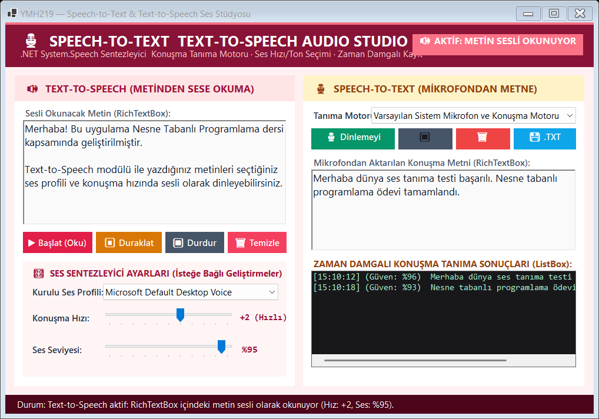
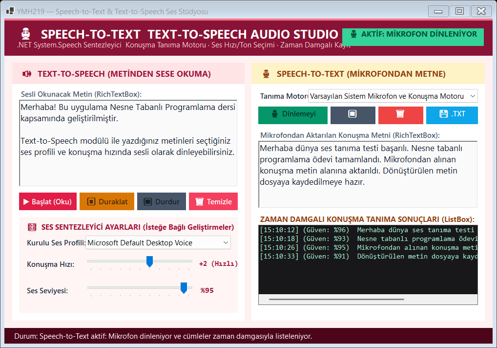

# 🎙️ YMH219 — Speech-to-Text ve Text-to-Speech Uygulaması

> **Nesne Tabanlı Programlama (YMH 219)** dersi kapsamında C#, Windows Forms ve `.NET System.Speech` kütüphanesi kullanılarak geliştirilmiş, **Coral Audio Studio** arayüz tasarımına sahip çift yönlü ses-metin dönüşüm uygulaması.

---

## 📌 Proje Adı ve Kısa Açıklama

**YMH219-SpeechApp**, kullanıcının `RichTextBox` alanına yazdığı metinleri seçilen ses profili ve konuşma hızında sesli olarak okutabildiği (**Text-to-Speech / TTS**) ve mikrofondan alınan konuşmayı gerçek zamanlı olarak metne dönüştürüp zaman damgasıyla listeleyebildiği (**Speech-to-Text / STT**) nesne tabanlı bir masaüstü uygulamasıdır.

Projede ses sentezleme (`TextToSpeechService`), konuşma tanıma (`SpeechToTextService`) ve dosya dışa aktarım (`SpeechFileExporter`) işlemleri bağımsız sınıflarda kapsüllenmiş; `IDisposable` ile ses aygıtı kaynak yönetimi ve mikrofon/dil paketi erişim hataları güvenli biçimde ele alınmıştır.

---

## 🛠️ Kullanılan Teknoloji / NuGet Paketleri

| Bileşen | Detay |
| :--- | :--- |
| **Programlama Dili** | C# 12 |
| **Çatkı (Framework)** | .NET (`net10.0-windows` / Windows Forms) |
| **NuGet Paketi** | `System.Speech` (`9.0.0`) — `System.Speech.Synthesis` & `System.Speech.Recognition` |
| **Dosya İşlemleri** | `System.IO.StreamWriter` (UTF-8 `.txt` transkript dışa aktarımı) |

---

## 🚀 Kurulum ve Çalıştırma Adımları

1. **Depoyu klonlayın:**
   ```bash
   git clone https://github.com/fatmaturkmen244-spec/YMH219-SpeechApp.git
   cd YMH219-SpeechApp
   ```
2. **NuGet paketlerini geri yükleyin ve çalıştırın (.NET CLI):**
   ```bash
   dotnet restore
   dotnet run --project SpeechApp/SpeechApp.csproj
   ```
3. **Visual Studio ile çalıştırma:**
   - `YMH219-SpeechApp.sln` dosyasını **Visual Studio 2022** (veya üzeri) ile açın ve `F5` tuşuna basın.

---

## ✨ Uygulamanın Temel Özellikleri

- **Text-to-Speech (Metinden Sese Okuma):**
  - `RichTextBox` içindeki metni sesli olarak okuma (**Başlat**), **Duraklat / Devam Et**, **Durdur** ve **Temizle** kontrolleri.
  - **Ses Hızı (`-10` .. `+10`)**, **Ses Seviyesi (`%0` .. `%100`)** ve işletim sisteminde kurulu **Ses Profili (`InstalledVoices`)** seçimi *(İsteğe Bağlı Geliştirme)*.
- **Speech-to-Text (Konuşmadan Metne Dönüşüm):**
  - Varsayılan mikrofon üzerinden alınan konuşmayı metin alanına aktarma.
  - Tanınan her cümlenin `[HH:mm:ss]` zaman damgası ve `%Güven` skoru ile `ListBox` üzerinde listelenmesi *(İsteğe Bağlı Geliştirme)*.
  - Dönüştürülen metni ve zaman damgalı konuşma geçmişini **.TXT dosyasına kaydetme** *(İsteğe Bağlı Geliştirme)*.
- **Açık Durum Göstergesi ve Hata Yönetimi:**
  - Üst barda o anda hangi işlemin aktif olduğu (`🔊 TTS Aktif`, `⏸ TTS Duraklatıldı`, `🎙️ STT Mikrofon Dinleniyor`, `⚪ Boşta`) renk kodlu rozetle gösterilir.
  - Mikrofon takılı olmadığında veya Windows Speech Recognition dil paketi eksik olduğunda uygulama çökmez; kullanıcıya anlaşılır Türkçe hata mesajı sunar.

---

## 📸 Ekran Görüntüleri

### 1. Text-to-Speech (TTS) Aktif — Sesli Okuma ve Ses Hızı/Profil Ayarları


### 2. Speech-to-Text (STT) Aktif — Mikrofon Dinleme ve Zaman Damgalı Sonuç Listesi


---

## ⚠️ Bilinen Sınırlamalar / Geliştirme Notları

- `System.Speech.Recognition.SpeechRecognitionEngine` sınıfı Windows işletim sisteminde yüklü olan masaüstü konuşma tanıma motorlarını (`SAPI`) kullanır. Sistemde konuşma tanıma dil paketi yüklü değilse kullanıcıya bilgilendirici uyarı penceresi gösterilir.
- Sesli okuma (`SpeechSynthesizer`) Windows'ta kurulu olan varsayılan TTS ses profillerini otomatik olarak algılar.

---

## 👤 Öğrencinin Adı-Soyadı ve Öğrenci Numarası

- **Adı Soyadı:** Fatma Türkmen
- **Öğrenci Numarası:** *(Öğrenci Numaranız)*
- **Ders:** YMH 219 — Nesne Tabanlı Programlama
